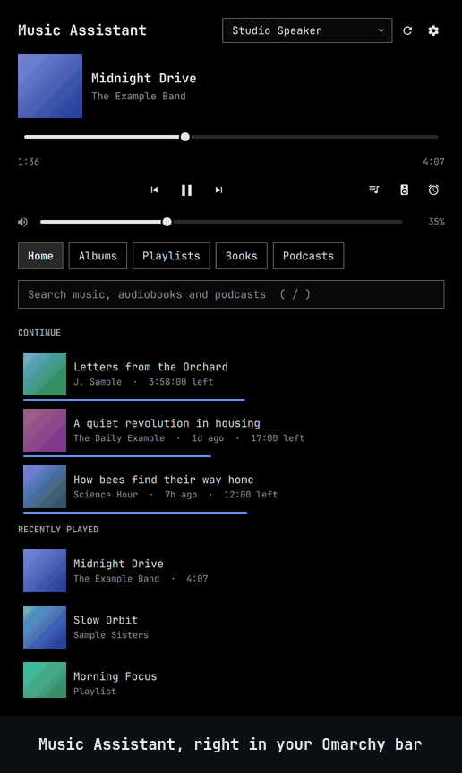
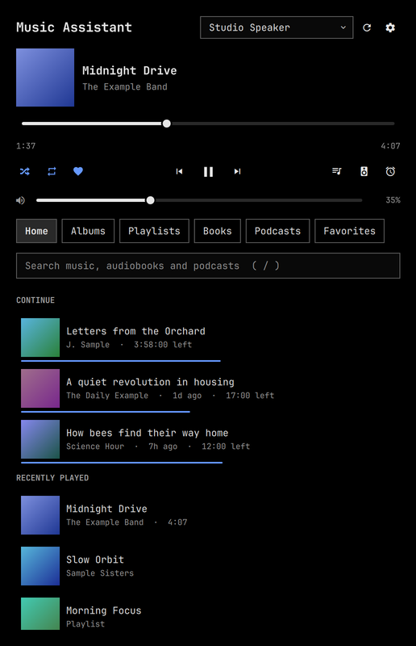
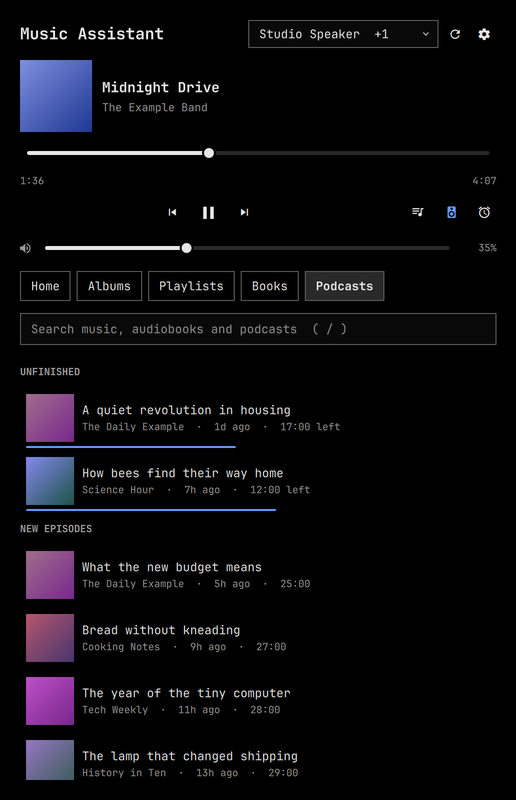
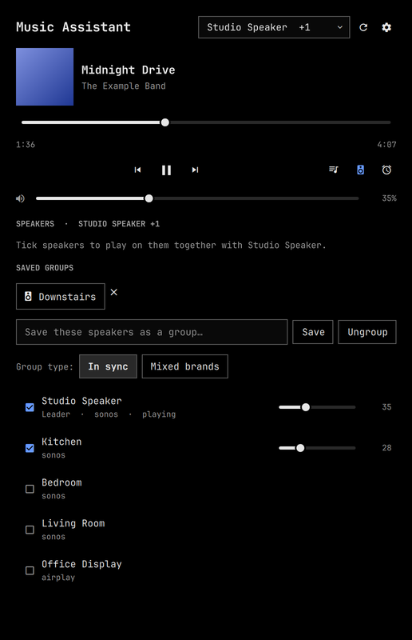
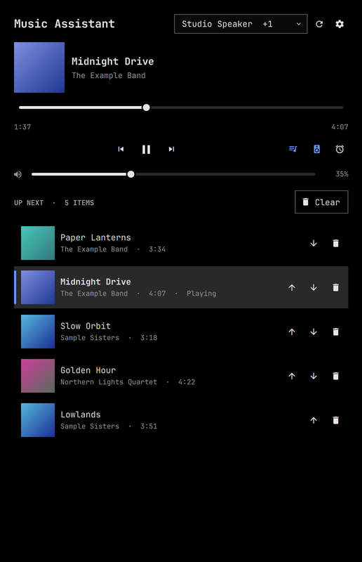
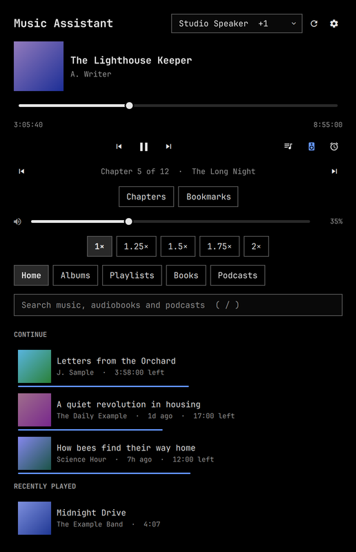
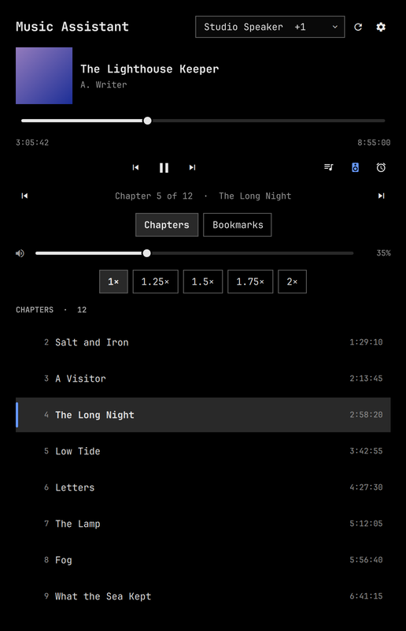
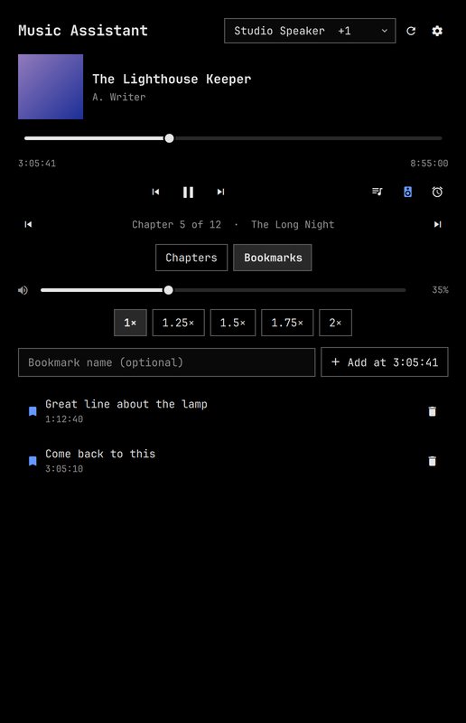
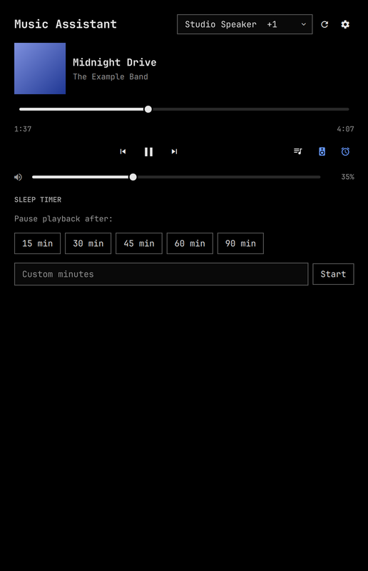
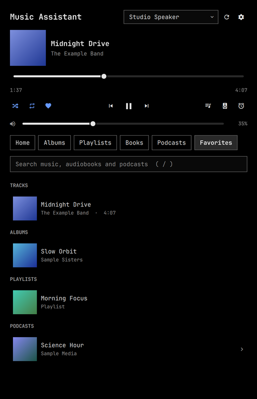

<h1 align="center">MA Bar</h1>

<p align="center">
  <b>Music Assistant in your Omarchy bar.</b><br>
  Your whole library, one bar icon away.<br>
  Music, audiobooks and podcasts, with a play queue, multi-room speaker groups,
  chapters, bookmarks and a sleep timer.
</p>

<p align="center">
  <a href="https://github.com/amlucent/omarchy-ma-bar/releases"></a>
  <a href="LICENSE"></a>
  
  
  
</p>

<p align="center">
  
</p>

<p align="center"><sub>Demo uses made-up data. Not affiliated with or endorsed by the Music Assistant or Omarchy projects.</sub></p>

## Why you'll like it

| | |
| --- | --- |
| 🎧 **One bar icon, everything inside** | Left click opens the dropdown, middle click plays / pauses, right click skips. |
| 🔊 **Real multi-room groups** | Tick speakers to play together, balance each one's volume, save the set as a *real* Music Assistant group. |
| 🎙️ **Podcasts done right** | Your unfinished episodes first, then the newest across every show. |
| 📚 **Audiobook friendly** | Chapters, resume progress, mark as played, and your Audiobookshelf bookmarks. |
| 🌙 **Sleep timer** | 15 to 90 minutes, custom, or end of chapter. It pauses, so you keep your place. |
| 🔒 **Private by design** | Tokens live in your system keyring, never in a file or on a command line. |

**Jump to:** [Screenshots](#screenshots) · [Quick start](#quick-start) · [Features](#features) · [Audiobookshelf](#audiobookshelf-optional) · [Keybindings](#keybindings) · [Troubleshooting](#troubleshooting)

## Status

**Beta (v0.9).** It is used daily and has a unit-test suite, but it has been tried on one
setup so far: Music Assistant 2.10 with Sonos and AirPlay players, saved groups, and an
Audiobookshelf library. Other player types (Chromecast, DLNA, the Companion app's own
player) should work because everything goes through Music Assistant, but are less tested.
Please [open an issue](../../issues/new/choose) if something misbehaves, and include your
plugin and Music Assistant versions.

## Screenshots

<table>
  <tr>
    <td align="center"><br><sub><b>Now playing and Home</b></sub></td>
    <td align="center"><br><sub><b>Podcasts: unfinished and newest</b></sub></td>
    <td align="center"><br><sub><b>Speakers and groups</b></sub></td>
  </tr>
  <tr>
    <td align="center"><br><sub><b>Play queue</b></sub></td>
    <td align="center"><br><sub><b>Audiobook controls</b></sub></td>
    <td align="center"><br><sub><b>Chapters</b></sub></td>
  </tr>
  <tr>
    <td align="center"><br><sub><b>Bookmarks (Audiobookshelf)</b></sub></td>
    <td align="center"><br><sub><b>Sleep timer</b></sub></td>
    <td align="center"><br><sub><b>Favorites</b></sub></td>
  </tr>
</table>

<sub>Screenshots use made-up demo data (see <code>tools/demo_server.py</code>).</sub>

## Quick start

1. **Install** and enable the plugin:

   ```
   omarchy plugin add https://github.com/amlucent/omarchy-ma-bar --enable
   ```

   If **Music Assistant** doesn't appear in the bar, add it in the shell's bar settings.

2. **Create a token** in Music Assistant: open its web UI, then your profile menu,
   and create a **long-lived access token**. Copy it.

3. **Connect**: click the bar icon. The dropdown opens on a connect form. Enter your
   server address (for example `http://192.168.1.10:8095`) and paste the token.
   Setup checks the token against your server before saving anything.

4. **Pick a player** from the list at the top of the dropdown (the plugin remembers
   it), then browse and play.

That's all most people need. Audiobookshelf is optional, see
[Audiobookshelf](#audiobookshelf-optional) before setting it up.

## Requirements

- A Music Assistant server (developed against 2.10) and a long-lived access token.
- `python3`, `secret-tool` (package `libsecret`) and a running keyring that provides
  the Secret Service, such as gnome-keyring. Your tokens are stored there.
- Optional: the [Music Assistant Companion](https://www.music-assistant.io/companion-app/)
  app, but **only** if you want to play audio on this computer's own speakers. It
  registers this computer as a player in Music Assistant, and it is the **supported**
  way to do that. Without it the plugin works fully with every other player on your
  server (Sonos, AirPlay, Chromecast and so on). If no player has been chosen and this
  computer has none, the dropdown opens its player picker for you. There is also an
  [experimental lightweight alternative](#play-on-this-computer-without-the-companion-app-experimental).

## Play on this computer without the Companion app (experimental)

The plugin only *controls* Music Assistant; audio is played by a "player". The Companion
app is the supported way to make this computer one. If you'd rather not install it, the
small command-line [Sendspin](https://github.com/Sendspin/sendspin-cli) player can do the
same job. This was tested once, on an Apple Silicon laptop running Omarchy with PipeWire
and Music Assistant 2.10 (audio played through the normal system output). It is **not
supported** yet and may need adjusting on your setup.

1. **Install the player** (needs `uv` and `portaudio`, both normally present on Omarchy):

   ```
   uv tool install sendspin
   ```

2. **Test it in a terminal.** Replace the address with your Music Assistant server. The port
   is Music Assistant's Sendspin port, `8927` by default:

   ```
   cd ~/.config/omarchy/plugins/ma-bar
   ~/.local/share/uv/tools/sendspin/bin/python tools/sendspin-pipewire.py ws://YOUR-SERVER:8927/sendspin
   ```

   A player named after this computer's hostname should appear in Music Assistant. Keep the
   volume low for the first test.

3. **Run it in the background** with a systemd user service,
   `~/.config/systemd/user/sendspin.service`:

   ```
   [Unit]
   Description=Sendspin player for Music Assistant
   After=network-online.target pipewire.service

   [Service]
   ExecStart=%h/.local/share/uv/tools/sendspin/bin/python %h/.config/omarchy/plugins/ma-bar/tools/sendspin-pipewire.py ws://YOUR-SERVER:8927/sendspin
   Restart=on-failure
   RestartSec=5

   [Install]
   WantedBy=default.target
   ```

   ```
   systemctl --user daemon-reload
   systemctl --user enable --now sendspin.service
   ```

4. In the dropdown, choose the player named after your computer. If no player is chosen,
   the plugin finds it automatically.

Notes and known problems:

- **Why `--url` and a wrapper script?** Sendspin normally finds servers by mDNS, which does
  not cross subnets or VLANs, so the player connects to the server directly. On PipeWire,
  Sendspin can also hang while testing which audio formats the output supports;
  `tools/sendspin-pipewire.py` skips that test. It relies on Sendspin's internals, so a
  Sendspin update may break it.
- The player shows up in Music Assistant as a "universal player", and it is created the
  first time it connects. Delete it in Music Assistant's player settings if you stop using it.
- Using the sound server's normal device (`pipewire`) matters: on some hardware, such as
  Apple Silicon laptops, the speakers depend on a PipeWire filter, so avoid pointing the
  player at a raw hardware device.

## Features

**Bar icon**

- Shows whether your player is playing, with a tooltip of the current title and
  artist or author.
- Left click opens the dropdown, middle click plays / pauses, right click skips to
  the next item.

**Dropdown**

- Cover, title, seek bar, previous / play / next, volume, and playback speed for
  audiobooks and podcasts.
- **Shuffle and repeat** (off / whole queue / this item) for music, and a **heart** to add
  or remove the playing track or book from your favorites.
- Tabs: **Home** (continue and recently played), **Albums**, **Playlists**,
  **Books**, **Podcasts** and **Favorites**, plus search across music, audiobooks and
  podcasts.
- **Favorites:** right-click an album, playlist, track, book or podcast to add it to or
  remove it from your Music Assistant favorites; the **Favorites** tab lists them.
- **Podcasts tab:** your unfinished episodes first, then the newest episodes across
  all your shows (with how long ago they came out), then the shows themselves.
  Click a show to see its own episodes.
- **Continue / resume:** items you've started show time left and a progress bar.
- Keyboard friendly, see [Keyboard](#keyboard).

**Queue**

- The queue button shows what's up next. The item that's playing is pinned at the top
  (it can't be moved), and items that already played are hidden. For everything below it,
  use **play now** to jump straight to it, move it up or down, or remove it. You can also
  clear the queue.
- **Right-click** any album, playlist, track, audiobook or episode for **Play now**,
  **Play next** and **Add to queue**.

**Speakers and groups**

- The speaker button lists every player that can join the one you're controlling.
  Tick a speaker to play on it together with the leader, untick to remove it, and
  use each row's slider for per-speaker volume. "Ungroup" dissolves an ad-hoc group.
- **Save these speakers as a group** creates a real Music Assistant group player, so
  it also appears in Music Assistant's own apps and in the player picker here. Saved
  groups are listed as buttons: click one to control it, click its cross twice to
  delete it (only group players can be deleted from here, never a real speaker).
  Members of a saved group can be ticked on and off like any other group.
- Groups made in the Sonos app are picked up too.
- **Move playback here:** the arrow button on a speaker moves the whole queue (and what is
  playing) to that speaker.
- **Group type:** "In sync" uses Music Assistant's Sync Group provider (built in).
  When the ticked speakers are different brands and Music Assistant's
  *Universal Group Player* provider is enabled, a "Mixed brands" type is offered;
  those groups play the same audio but are not sample-synced.

**Audiobooks and podcasts**

- **Chapters:** a chapter line with previous / next chapter (previous restarts the
  chapter first, like a CD player), and a **Chapters** list to jump anywhere.
- **Mark as played / unplayed:** right-click an audiobook or podcast episode.
  "Reset progress" appears for items you've started.
- **Bookmarks:** make, jump to and delete bookmarks on audiobooks. This needs
  Audiobookshelf, see below.

**Sleep timer**

- The alarm-clock button opens 15 / 30 / 45 / 60 / 90 minute presets, a custom
  minutes box and (for audiobooks) "End of chapter".
- The bar shows the time left, and the timer keeps running with the dropdown
  closed. When it ends playback is **paused**, not stopped, so your queue and
  position are kept.

## How this compares

There is another Omarchy plugin for Music Assistant,
[manologarciadev/omarchy.music-assistant](https://github.com/manologarciadev/omarchy.music-assistant)
(compared at its v1.0.5). It is a solid music-focused remote, and you can reasonably pick
either. This plugin was built around a different set of needs:

| | **This plugin** | **omarchy.music-assistant** |
| --- | --- | --- |
| Best for | Music **plus audiobooks and podcasts**, and multi-room | Music: favorites, playlists, recents |
| Audiobooks and podcasts | Chapters, resume, mark played, Audiobookshelf bookmarks, an unfinished-and-newest Podcasts tab | Not covered |
| Speaker groups | Tick-to-group, per-speaker volume, saved real Music Assistant groups | Shows group members |
| Queue | Pinned now-playing, play now, reorder, remove, clear, right-click Play now / next / Add to queue, move playback to another speaker | Click to play, remove, transfer to another player, save the queue as a playlist |
| Sleep timer | Yes | No |
| Favorites, shuffle, repeat | Yes | Yes |
| Keyboard navigation | Yes | Yes |
| Media keys | Documented bindings you add yourself | Installs Hyprland media-key bindings for you |
| Token storage | System keyring | A `config.json` file (mode 0600) |
| Per-player power and mute | No | Yes |

Things the other plugin does that this one does not (yet): save the current queue as a
playlist, and per-player mute / power. If those matter most to you, try it.

## Audiobookshelf (optional)

**You do not need an Audiobookshelf token to listen to audiobooks.** Playing books,
chapters, resume positions and "mark as played" all work through Music Assistant
alone.

Connect Audiobookshelf only if **both** of these are true:

1. Audiobookshelf is one of your **Music Assistant sources** (a provider added in
   Music Assistant's settings), and
2. you want to **see and use your Audiobookshelf bookmarks** from this plugin (and
   reset an Audiobookshelf item to unplayed).

Music Assistant has no bookmark feature and does not pass Audiobookshelf's
bookmarks through, so the plugin talks to your Audiobookshelf server directly for
those. It also uses that connection for "Mark as unplayed" / "Reset progress" on
Audiobookshelf items, because Music Assistant doesn't forward that to
Audiobookshelf.

To connect, create an API token in Audiobookshelf (Settings, then Users, then your
user), then enter your Audiobookshelf address and the token under the gear icon in
the dropdown, or from a terminal:

```
cd ~/.config/omarchy/plugins/ma-bar
read -rs ABS_TOKEN; printf '%s\n' "$ABS_TOKEN" | python3 scripts/ma_backend.py abs-setup https://YOUR-AUDIOBOOKSHELF; unset ABS_TOKEN
```

The token goes into the system keyring, separate from the Music Assistant token.
Bookmarks only work for audiobooks that come from Audiobookshelf (not podcast
episodes). To remove it, use **Disconnect** in the same settings section or
`python3 scripts/ma_backend.py abs-disconnect`.

## Connecting from the command line

Prefer a terminal to the connect form? The token is read without echo and sent to
the keyring on stdin, so it never appears on a command line or in a file.

```
cd ~/.config/omarchy/plugins/ma-bar
read -rs MA_TOKEN; printf '%s\n' "$MA_TOKEN" | python3 scripts/ma_backend.py setup http://YOUR-SERVER:8095; unset MA_TOKEN
```

By default the plugin controls the Music Assistant player that matches this
computer's hostname (the Companion app). To control a different player, pick it in
the dropdown or:

```
python3 scripts/ma_backend.py players            # list players and their ids
python3 scripts/ma_backend.py set-player <id>
```

To disconnect and remove the saved tokens and settings:

```
python3 scripts/ma_backend.py disconnect
```

## Keybindings

The widget exposes commands you can bind in Hyprland:

```
omarchy-shell ma-bar toggle          # open / close the dropdown
omarchy-shell ma-bar playPause
omarchy-shell ma-bar next
omarchy-shell ma-bar previous
omarchy-shell ma-bar queue           # open the queue
omarchy-shell ma-bar chapters
omarchy-shell ma-bar bookmarks
omarchy-shell ma-bar speakers
omarchy-shell ma-bar library
omarchy-shell ma-bar tab podcasts    # home | albums | playlists | audiobooks | podcasts | favorites
omarchy-shell ma-bar sleep 30        # pause after 30 minutes
omarchy-shell ma-bar sleepMenu
omarchy-shell ma-bar sleepCancel
```

### Media keys

Omarchy routes the keyboard's media keys to whatever is playing. To send them to Music
Assistant instead, add this to `~/.config/hypr/bindings.lua` (adapted from Omarchy's own
`media.lua`; `o.rebind` replaces the default binding). The plugin does **not** edit your
Hyprland config for you.

```lua
o.rebind("XF86AudioPlay", "Play (Music Assistant)", "omarchy-shell ma-bar playPause", { locked = true })
o.rebind("XF86AudioPause", "Pause (Music Assistant)", "omarchy-shell ma-bar playPause", { locked = true })
o.rebind("XF86AudioNext", "Next (Music Assistant)", "omarchy-shell ma-bar next", { locked = true })
o.rebind("XF86AudioPrev", "Previous (Music Assistant)", "omarchy-shell ma-bar previous", { locked = true })
```

Prefer to keep the defaults for browser and video playback? Use a different key combination
with `o.bind` instead.

### Keyboard

With the dropdown open:

| Key | Action |
| --- | --- |
| `Space` | Play / pause |
| `/` | Search |
| `↑` `↓` (or `k` `j`) | Move the cursor through the current list (library, queue, chapters, bookmarks, speakers) |
| `Enter` | Open the row under the cursor: play it, jump to a queue item or chapter, tick a speaker |
| `Delete` (or `x`) | Remove the queue item, or delete the bookmark, under the cursor |
| `Ctrl` + `↑` `↓` | Move the queue item under the cursor up or down |
| `1` to `6` | Jump to Home, Albums, Playlists, Books, Podcasts, Favorites |
| `Tab` / `Shift` + `Tab` | Next / previous tab |
| `Esc` | Back, then close |

## Troubleshooting

- **Tooltip says "not connected"**: finish the connect form (gear icon) or run `setup`.
- **Tooltip says "choose a player"**: pick a player from the dropdown. This happens when
  no player is chosen and this computer isn't registered as one.
- **Tooltip says "server unreachable"**: check the server address and that the server is
  running.
- **A track won't play**: playback goes through your Music Assistant server, so a failing
  provider there (for example Spotify) fails here too. Try a library track to confirm.
- **QML edits don't show up** (development): run `omarchy-restart-shell`.

## Roadmap

Ideas, in no particular order. If one matters to you, [say so in an issue](../../issues) so
it can be prioritised:

- **A built-in "This computer" switch** that sets up and manages the lightweight local
  player above for you (install check, background service, status, test sound), so the
  Companion app is no longer needed. See the
  [tracking issue](../../issues?q=is%3Aissue+%22This+computer%22).
- Album and artist pages.
- Save the queue as a playlist, and per-player mute / power.
- Pagination for very large libraries (the lists load the first 60 items today).
- Chapters and bookmarks for podcast episodes.

## Privacy and security

- Tokens live only in the system keyring. The settings file
  (`~/.config/omarchy-music-assistant/config.json`) holds just the server addresses and
  your chosen player.
- The plugin talks only to the Music Assistant (and, if you connect it, Audiobookshelf)
  addresses you give it.
- Artwork addresses returned by some providers can embed access tokens; the plugin does
  not log them.

## Development

```
python3 -I -m unittest discover -s tests -v
omarchy plugin validate .
```

`tools/demo_server.py` is a small fake Music Assistant + Audiobookshelf server with
made-up data, handy for trying the UI without a real server and for retaking the
screenshots without exposing a real library. Run it with
`python3 tools/demo_server.py` and point the plugin at `http://127.0.0.1:8099` with any
token. `curl localhost:8099/__demo/mode/book` (or `podcast`, `music`) changes what is
"playing".

`MA_PLUGIN_URL` and `MA_PLUGIN_TOKEN` (and `MA_PLUGIN_ABS_URL` / `MA_PLUGIN_ABS_TOKEN`)
environment variables override the saved settings for local testing only.

## License

MIT. See [LICENSE](LICENSE). The bar-widget structure follows the conventions of
other Omarchy plugins such as
[audiobookshelf-player](https://github.com/jtcarrasco/audiobookshelf-player).
